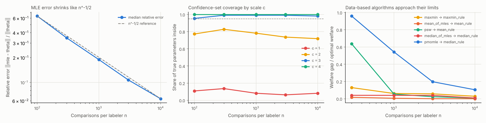

# Sanity report

22 of 22 checks passed (22s, 10 seeds).

| | Check | Expected | Observed |
|---|---|---|---|
| PASS | Data: increasing n only adds examples | first 100 examples identical for n = 100 and n = 1000 | identical: True |
| PASS | Data: a lie changes only the liar's labels | labels of the other 10 labelers unchanged | unchanged: True; liar's labels changed: 201 of 1000 |
| PASS | Data: labels follow Bradley-Terry | empirical preference rate = model probability (within sampling error) | |empirical - model| = 0.0041 over 11,000 labels |
| PASS | Data: label noise is realistic at the defaults (B = 3) | labels agree with the stronger preference 60-75% of the time (human annotators: ~65-75%) | 65% |
| PASS | Estimation: MLE is consistent | relative error shrinks like n^-1/2 (log-log slope ~ -0.5) | median relative error 0.64, 0.35, 0.19, 0.11, 0.06 at n = [100, 300, 1000, 3000, 10000]; slope -0.50 |
| PASS | Estimation: confidence sets are valid at c = 3 (the default) | true parameter inside its confidence set >= 95% of the time, at every n | per labeler 0.95, 0.99, 0.99, 0.99, 0.98; all 11 at once 0.50, 0.90, 0.90, 0.90, 0.90 |
| PASS | Estimation: the paper's radius without constants (c = 1) is too small | documents why c is calibrated rather than set to 1 | per-labeler coverage at c = 1: 0.09 |
| PASS | Paper Prop. 3.3: Pessimistic Social Welfare is manipulable (with data) | lie (1, -1) raises labeler 1's utility by 0.25 (1/2 -> 3/4) | gain 0.250 |
| PASS | Paper Prop. 3.3: MaxMin-RLHF is manipulable (with data) | lie raises labeler 1's utility; with stochastic policies by 0.25 x 4/7 = 0.143 | gain 0.133 |
| PASS | Writeup example: Alice's exaggeration flips pooled BTL from D to C | pooled r(C) - r(D) = -0.204 (D wins), then 0.041 after the lie (C wins) | estimated -0.208, then 0.041 |
| PASS | Algorithms: maxmin converges to maxmin_rule as n grows | welfare gap (as a fraction of optimal welfare) shrinks with n | gap 0.129, 0.061, 0.057, 0.029 at n = [300, 1000, 3000, 10000] |
| PASS | Algorithms: mean_of_mles converges to mean_rule as n grows | welfare gap (as a fraction of optimal welfare) shrinks with n | gap 0.016, 0.006, 0.000, 0.000 at n = [300, 1000, 3000, 10000] |
| PASS | Algorithms: psw converges to mean_rule as n grows | welfare gap (as a fraction of optimal welfare) shrinks with n | gap 0.637, 0.054, 0.023, 0.007 at n = [300, 1000, 3000, 10000] |
| PASS | Algorithms: median_of_mles converges to median_rule as n grows | welfare gap (as a fraction of optimal welfare) shrinks with n | gap 0.040, 0.039, 0.039, 0.009 at n = [300, 1000, 3000, 10000] |
| PASS | Algorithms: pmomle converges to median_rule as n grows | welfare gap (as a fraction of optimal welfare) shrinks with n | gap 0.959, 0.543, 0.197, 0.104 at n = [300, 1000, 3000, 10000] |
| PASS | Algorithms: truthful welfare at n = 3000 (normalized suboptimality, 0 = optimal) | pooled BTL and mean of MLEs ~0; pessimistic methods pay for their caution | pooled_btl 0.000, psw 0.023, maxmin 0.237, pmomle 0.232, median_of_mles 0.080 |
| PASS | Rotation: basis-independent algorithms are unaffected by rotating the box | identical welfare with and without rotation (solver tolerance) | max difference pooled_btl 2.2e-16, maxmin 4.7e-11, psw 3.0e-05, mean_of_mles 2.2e-16 |
| PASS | Rotation: coordinate-wise median methods do change | PMoMLE and median of MLEs depend on the basis | max difference pmomle 0.320, median_of_mles 0.062 |
| PASS | Incentives (box env, perfect data): the median rule is exactly strategyproof | no lie helps the liar (paper's Case 1); 7 structured + 40 random lies per seed | largest gain from any lie: 0.0e+00 |
| PASS | Incentives (box env, perfect data): the mean rule is not | steering the mean gains a clearly positive share of the liar's utility range | gain 0.199 ± 0.043 |
| PASS | Incentives (box env, n = 3000, as in the experiment): lying doesn't pay under PMoMLE but does under PSW | PMoMLE ~ 0 (< 2% of utility range) for exaggerating x5 and steering the mean; PSW > 5% | exaggerate: pmomle 0.006 ± 0.003, pooled_btl 0.039 ± 0.023, psw 0.111 ± 0.023; steer_mean: pmomle 0.002 ± 0.002, pooled_btl 0.084 ± 0.029, psw 0.177 ± 0.032 |
| PASS | Reproducibility: same seed, same numbers | rerunning a trial reproduces every value; with 0% strategic the strategy setting is irrelevant | rerun identical: True; 0%-strategic identical across strategies: True |

